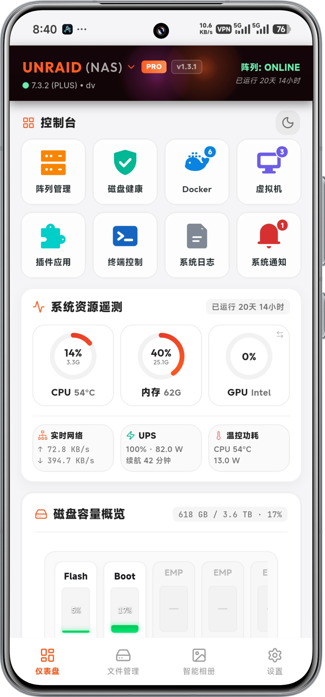
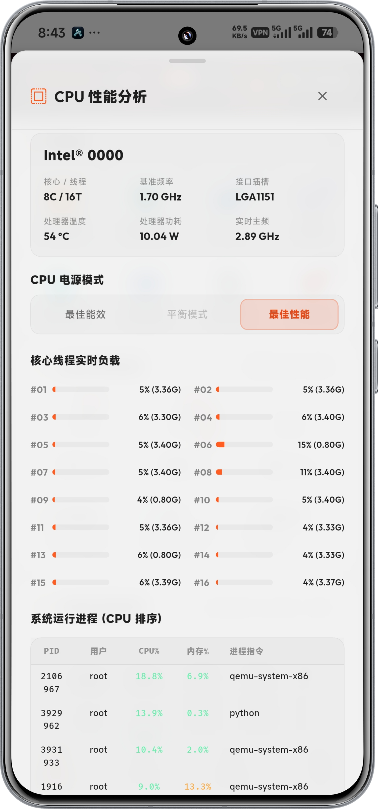
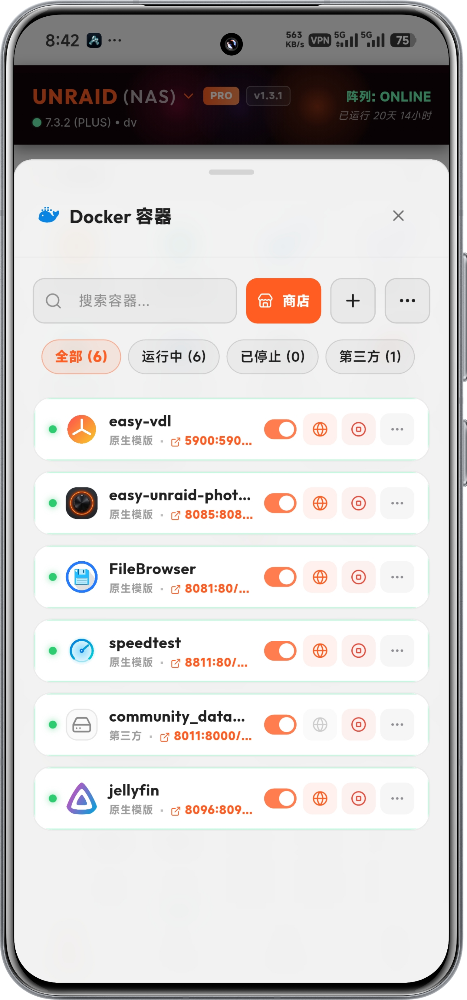
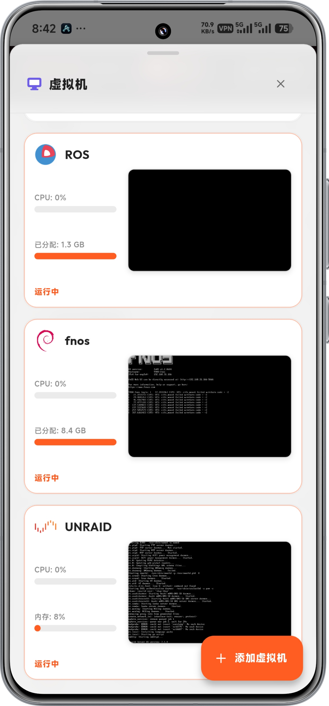
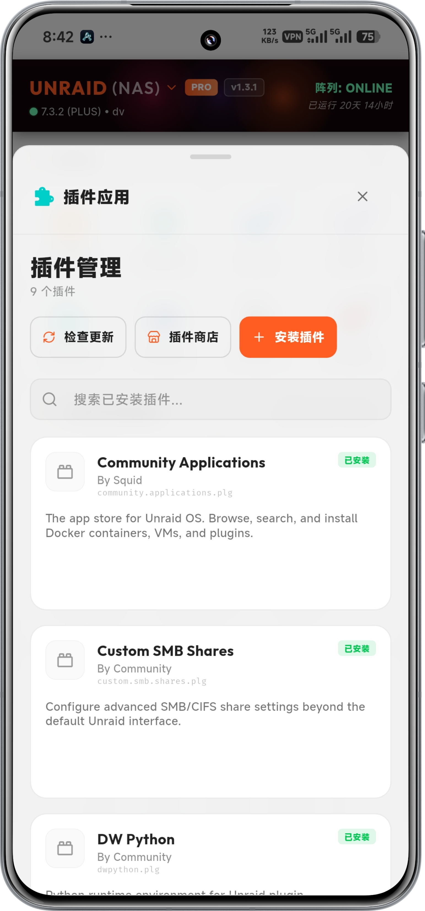
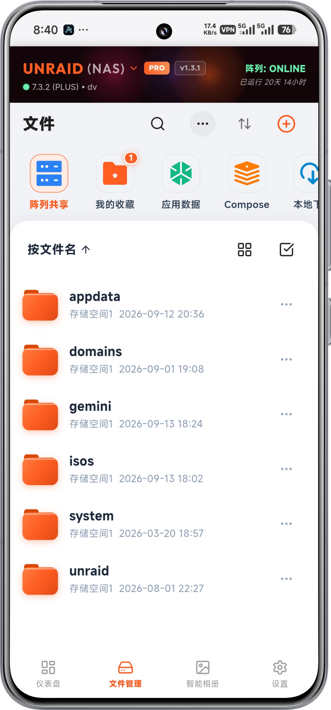
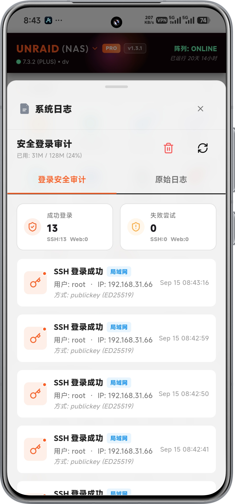
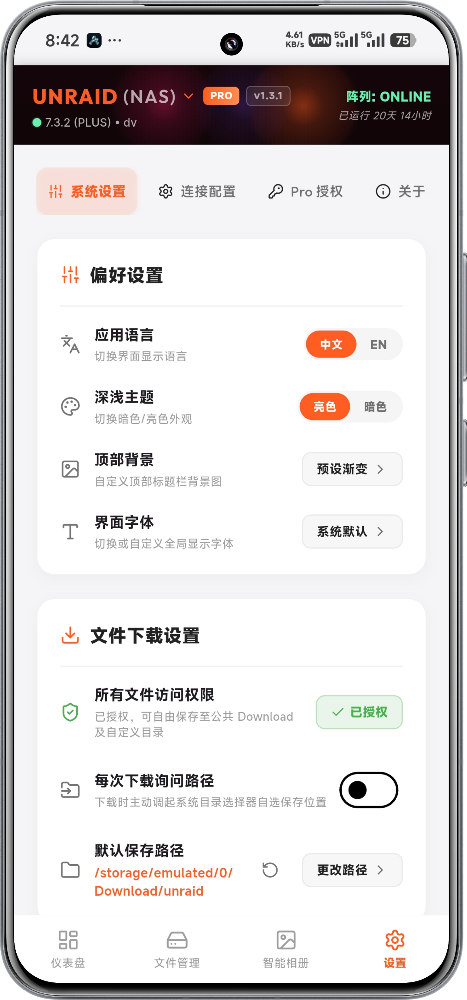

<a name="readme-top"></a>

# 🚀 Easy Unraid

<p align="center">
  
</p>

<p align="center">
  <strong>一款简洁、优雅且安全的跨平台 Unraid 服务器管理器</strong>
</p>

<p align="center">
  <a href="https://flutter.dev"></a>
  <a href="https://apps.apple.com/app/id6794758591"></a>
  <a href="https://github.com/wlaosj/easy-unraid-releases/releases"></a>
  <a href="https://github.com/wlaosj/easy-unraid-releases/releases/latest"></a>
  <a href="https://gitee.com/wdv880518/easy-unraid"></a>
  <a href="https://t.me/+7jcTMePlNVwwZjg1"></a>
  
</p>

<p align="center">
  
</p>

---

## 📌 目录 (Table of Contents)

<details open>
<summary><b>📖 点击展开/折叠目录大纲 (Click to Toggle)</b></summary>

*   **[🇨🇳 中文介绍](#intro-zh)**
    *   [✨ 核心功能亮点](#features-zh)
    *   [🚀 快速配对指南](#quick-start-zh)
    *   [🌐 外网安全访问建议](#remote-zh)
    *   [💎 免费版与专业版说明](#free-vs-pro-zh)
    *   [🛒 Pro 终身授权与卡密购买](#pricing-zh)
    *   [📥 客户端下载通道](#downloads-zh)
    *   [🛡️ 安全背书与极客审计](#security-zh)
*   **[🇺🇸 English Introduction](#intro-en)**
    *   [✨ Key Features](#features-en)
    *   [🚀 Quick Start Guide](#quick-start-en)
    *   [🌐 Remote Access & Security](#remote-en)
    *   [💎 Free vs Pro Edition](#free-vs-pro-en)
    *   [🛒 Purchase Pro Lifetime License](#pricing-en)
    *   [📥 Downloads](#downloads-en)
    *   [🛡️ Security & Privacy](#security-en)
*   **[📸 运行截图 (Screenshots)](#screenshots)**

</details>

---

<a name="intro-zh"></a>

## 🇨🇳 中文介绍

**Easy Unraid** 是一款基于 Flutter 构建的高性能、跨平台 Unraid 服务器原生管理客户端。全面适配 **Unraid 6.12 ~ 7.3.x 最新系统**，突破传统 Web 浏览器的交互与网络限制，为移动设备（iOS / Android）与桌面端（macOS / Windows）带来极致丝滑的硬件遥测、容器编排、离线 AI 实时同传、专业级影院播放器、自托管智能相册与极速文件管理体验。

<a name="features-zh"></a>

### ✨ 核心功能亮点

- **📊 实时硬件监测与官方设计语言**
  - **官方矢量图标体系**：全量集成 Unraid 官方原生矢量图标，经典爱马仕红橙（`#FF5D22`）点睛。
  - **优雅仪表盘**：Cupertino 运动圆环与跑车高精仪表盘重绘 CPU、内存与硬件指标。
  - **错层防重叠规范**：硬件 Logo 与高频实时折线波形错层隔离，彻底杜绝数据遮挡。
  - **极速主题切换**：支持顶部一键无感切换白金浅色与深邃暗夜模式。
- **🎙️ SODA 离线 AI 实时双语弹幕同传 (PRO)**
  - **100% 离线识别**：纯本地运行高效离线语音大模型，音频数据零出局域网，绝对保护私密观影隐私。
  - **8 国语音模型一键下载**：支持中、英、日、韩、法、德、西、意等多语种离线语音模型按需加载。
  - **双语平滑滚动字幕**：支持实时双语同步翻译、双行平滑滚动字幕呈现与精美高透毛玻璃弹幕动效。
  - **NAS 媒体库底层只读授权**：系统底层强制 `ro` 只读挂载保护，杜绝误写误删，保障磁盘资产绝对安全。
- **🎬 全平台专业影院级播放器 (PRO)**
  - **桌面大屏端**：宽屏双栏影院布局（左侧原画高帧视口 + 右侧可折叠选集连播列表），鼠标悬停唤醒控件，支持滚轮调音、双击全屏及全套键盘快捷键（`Space` 暂停、`←/→` 快进快退、`↑/↓` 音量、`F` 全屏、`M` 静音、`C` 弹幕、`Esc` 退出）。
  - **移动便携端**：支持上滑进入全屏、全屏下滑返回、标准态下滑收缩为画中画（PiP）小窗播放；支持双击快进快退与长按 2.0X 极速倍速。
  - **字幕与智能连播**：支持同目录影视自动连播定位、外挂中英双语字幕智能识别与合并。
- **🧠 自托管 AI 智能相册 (PRO)**
  - **自研后端**：一键部署轻量级自托管 Docker 容器（`easy-unraid-photos`），支持 GPU 硬件加速。
  - **离线语义搜图**：纯本地运行多模态 CLIP 智能搜索引擎，中英文自然语言输入秒级检索照片场景。
  - **离线人脸聚类**：纯本地人脸识别聚类算法，空闲内存超时自动释放回收，零云端隐私泄露。
  - **视频原画秒播**：支持配置视频动态预览时长（关闭 / 3s / 5s / 10s / 15s），关闭预览后零转码开销秒开原画。
  - **丝滑交互**：Pinch 双指网格缩放、大图视差滑屏、Hero 飞入动效与 120Hz 高刷贴手体验。
  - **智能 LAN 直连**：局域网自动探活直连（LAN Bypass），外网无缝回退安全加密 SSH 隧道。
- **🎧 官方直连技术支持与一键脱敏排障**
  - **应用内官方支持**：应用内集成实时双向沟通窗口，面向标准版与 Pro 版全体用户开放，直通研发团队。
  - **自动环境对齐**：自动关联脱敏设备识别码、客户端版本与 Unraid 系统版本，免去繁琐环境参数沟通。
  - **一键附带诊断日志**：一键对密码、API Key、SSH 私钥与 Token 进行严格正则脱敏后打包上传，协助极速排障。
  - **便捷入口**：设置中心「关于」、「高级版激活」与「换绑优盘」页面均提供一键直达支持通道。
- **🛒 Community Applications 官方社区应用商店 (PRO)**
  - **海量生态**：无缝接入 Unraid 官方百万级应用商店，秒级关键词检索与多维度分类浏览。
  - **XML 模版引擎**：深度解析原生 XML 容器模版，自动装配网络模式、端口映射、卷映射与环境变量。
- **🔌 插件全量检测与一键批量升级**
  - **静默检测**：后台静默检测已安装插件更新，多服务器沙盒物理隔离缓存。
  - **批量排队升级**：多插件更新时动态提供「全部更新 (Update All)」排队串行升级，避免进程锁死并提供实时日志流。
  - **版本对比与卸载**：支持 Markdown 历史版本更新日志对比与一键安全卸载。
- **🐳 Docker 容器与 Compose 编排 (PRO)**
  - **分立式现代控制栏**：独立搜索框 + 商店高亮入口 + 快捷添加 + 批量管理。
  - **元数据来源标记**：智能识别原生模版、CA 商店、Compose 堆栈，列表卡片智能去重端口。
  - **一键更新**：点击角标一键重建并自动拉取更新容器镜像。
  - **极客编排**：独家支持 Docker Compose 项目一键部署与内置 YAML 语法高亮编辑器。
  - **直观资源监控**：容器 CPU/内存实时进度条与 Network/Disk IO 彩色流量胶囊。
- **💾 阳极氧化铝 3D 拟物化阵列面板**
  - **工业美学机箱**：阳极氧化冷银铝合金前面板，状态与 LAN 指示灯高频流光。
  - **磁盘深度体检**：实时监测硬盘读写速度、工作温度、休眠运转状态及坏道 Errors 告警。
  - **SMART 三态判定**：SMART 重构为健康/未知/异常，自动过滤无传感器引导盘与虚拟设备。
- **📁 极速文件管理器与跨端分享转存 (PRO)**
  - **断点续传**：基于高性能 SFTP，大文件传输支持暂停、继续与网络中断自动重连续传。
  - **桌面拖拽**：macOS / Windows 独家支持直接将本地文件/文件夹拖入窗口极速上传。
  - **秒开缓存**：内置本地媒体缓存加速引擎，PDF 与高清大图二次打开秒开。
  - **系统级分享转存**：iOS / Android 系统级分享一键转存至 NAS，智能记忆最近存储路径。
  - **防灾物理回收站**：内置独立物理回收站缓冲机制，误删文件随时一键原路秒级还原。
- **🚀 虚拟机控制与内置 SSH 终端 (PRO)**
  - **VNC 远程桌面**：虚拟机状态一键启停，内置 Web 级无缝 VNC 远程控制台。
  - **深度融入终端**：SSH 终端卡片无缝融入仪表盘，支持右键菜单与剪贴板快捷粘贴（`Cmd/Ctrl+V`）。
  - **安全防误触**：支持指纹/面容/PIN 码生物认证保护，进入终端时不强制抢焦点，交互丝滑。
- **🔒 一键防爆破加固 (禁用 SSH 密码登录)**
  - **极客安全加固**：私钥配对成功后一键关闭 Unraid 的 SSH 密码登录通道，100% 免疫公网自动化字典暴力破解。
  - **引导盘持久化生效**：配置固化至引导 U 盘（`/boot/config/ssh/sshd_config`），系统升级与断电重启后永久生效。
- **🔋 UPS 备用电源监测**
  - **NUT 深度适配**：全量适配第三方 NUT 插件，实时展示 UPS 负载瓦数与预计电池续航时间。
  - **功耗历史趋势**：新增 UPS 功耗历史趋势曲线，数据异步解耦加载。
- **🎨 黄金自适应与跨端原生集成**
  - **大屏自适应规范**：桌面大屏下关键界面收敛为 `maxWidth: 820` 黄金居中比例，杜绝超宽屏过度拉伸。
  - **纯净矢量视觉**：全面去除易产生视觉噪点的 Emoji，统一为纯净线性的 `LucideIcons` 矢量图标。
  - **原生桌面小组件**：支持 iOS / Android / macOS 原生系统级桌面小组件，基于 App Group 共享沙盒秒级同步。
  - **macOS 静默热更**：macOS 桌面端支持一键检测、后台静默下载、热替换并无缝自动重启。

<p align="right">(<a href="#readme-top">⬆️ 返回顶部 / Back to Top</a>)</p>

---

<a name="quick-start-zh"></a>

### 🚀 快速配对指南 (Quick Start)

首次运行 App 时，在系统配置页需要完成**连接模式配置**与**安全 SSH 密钥配对**：

#### 第一步：选择连接模式 (Connection Mode)
- **直连模式 (Direct Connection)**：推荐在【局域网内网】或【已连接 VPN（WireGuard, Tailscale, ZeroTier）】时使用，延迟最低、传输性能最高。
- **SSH 隧道穿透 (SSH Tunneling)**：推荐在【外网远程访问】且未配置 VPN 时使用。只需在路由器映射 SSH 端口，App 即可自动建立端到端加密通道穿透 API 数据，实现 API 端口零暴露。

#### 第二步：进行安全 SSH 密钥配对 (SSH Pairing)
App 在本地绝不存储明文 root 密码。配对成功后统一走 RSA/ED25519 强加密 SSH 密钥对进行免密连接：
- **方式 A：自动免密注入（极简一步配对）**
  1. 输入服务器 IP 地址、端口及 `root` 账户密码；
  2. App 连通后自动生成高强度 SSH 密钥对并写入服务器闪存，配对成功后**明文密码在内存中立即物理抹除**。
- **方式 B：极客手动注入（推荐 - 100% 密码零接触）**
  1. 输入服务器 IP 地址及端口；
  2. 在 App 配置中生成或导入 SSH 密钥对，复制显示出的 **公钥 (Public Key)**；
  3. 登录 Unraid Web 管理页打开终端，将公钥内容追加到 `/boot/config/ssh/authorized_keys` 即可免密连接。

<p align="right">(<a href="#readme-top">⬆️ 返回顶部 / Back to Top</a>)</p>

---

<a name="remote-zh"></a>

### 🌐 外网安全访问建议 (Remote Access)

为了保障您的服务器资产绝对安全，在外网远程连接时**强烈建议优先使用 VPN 虚拟局域网（如 WireGuard、Tailscale 或 ZeroTier）**，而非在公网直接映射未加密的管理端口。

> [!WARNING]
> **风险提示**：Easy Unraid 需要同时与 Unraid API（HTTP/HTTPS 端口）及 SSH 控制台（22 端口）建立连接。直接将未加密的 Web 管理端口映射到公网极易遭受扫描撞库与恶意嗅探。

> [!IMPORTANT]
> **公网 SSH 隧道安全黄金法则**：  
> 若您在外网环境下选择【SSH 隧道穿透】并在路由器上暴露了 SSH 端口，**在 App 首次配对成功后，请务必前往「设置 ➔ 连接配置」中开启「禁用 SSH 密码登录 (防爆破)」**。开启后 Unraid 将彻底关闭密码登录与交互式鉴权，仅允许持有本设备私钥的客户端连入，100% 斩断公网黑客的自动化字典扫描与暴力破解通道。

> [!TIP]
> **VPN 组网优势**：
> * **隐蔽安全**：公网零暴露，所有流量端到端强加密。
> * **配置统一**：接入 VPN 后，App 内直接填写 Unraid **局域网内网 IP**（如 `192.168.31.99`）即可连接，免去频繁切换公私网地址的困扰。
> * **开箱即用**：Unraid 官方原生内置 WireGuard 支持；应用市场亦提供 Tailscale 和 ZeroTier 插件一键部署。

<p align="right">(<a href="#readme-top">⬆️ 返回顶部 / Back to Top</a>)</p>

---

<a name="free-vs-pro-zh"></a>

### 💎 免费版与专业版说明 (Free vs Pro)

Easy Unraid 采用“基础核心功能永久免费，高级生产力工具付费激活”的良性买断模式，以保障项目的长期高品质维护与迭代。

| 功能模块 | 免费版 (Free) | 专业版 (Pro) |
| :--- | :---: | :---: |
| **📊 实时硬件仪表盘概览** (首页 CPU/内存/实时网络波形/官方矢量图标) | **✅ 免费** | **✅ 免费** |
| **🖥️ 机箱阵列总览看板** (首页 3D 拟物机箱面板/总空间与运行状态概览) | **✅ 免费** | **✅ 免费** |
| **⚙️ 基础系统与连接配置** (多服务器切换/局域网直连/SSH 加密隧道/黄金自适应) | **✅ 免费** | **✅ 免费** |
| **🎧 官方直连技术支持** (双向客服沟通窗口/问题建议咨询/一键脱敏排障日志) | **✅ 免费** | **✅ 免费** |
| **🛡️ 登录安全审计** (SSH/Web 鉴权会话日志解析与图形化统计) | **✅ 免费** | **✅ 免费** |
| **🎬 全平台专业影院播放器** (双栏影院/全套快捷键/滚轮调音/PiP 画中画/外挂双语字幕合并) | 基础播放 | **✅ 影院全解锁** |
| **🎙️ SODA 离线 AI 实时同传** (纯本地流式语音识别/双语同传滚动字幕/8国语言模型/媒体库只读保护) | ❌ 需激活 | **✅ 解锁** |
| **💾 存储阵列二级体检详情** (各磁盘读写速度/温度监测/SMART 坏道深入体检) | ❌ 需激活 | **✅ 解锁** |
| **🐳 Docker 容器与 Compose 管理** (容器列表/日志/一键更新/YAML 高亮/编排部署) | ❌ 需激活 | **✅ 解锁** |
| **🔌 插件全量管理与批量升级** (插件列表/更新检测/日志对比/一键「全部更新」) | ❌ 需激活 | **✅ 解锁** |
| **🛒 Community Applications 官方应用市场** (CA 应用商店/XML 模版一键装配) | ❌ 需激活 | **✅ 解锁** |
| **📁 极速文件管理器** (SFTP 断点续传/4K 串流/解压/桌面拖拽/系统级分享转存/防灾回收站) | ❌ 需激活 | **✅ 解锁** |
| **🧠 自托管 AI 智能相册** (离线 CLIP 语义搜图/人脸聚类/大图视差滑屏/预览时长配置/LAN 直连) | ❌ 需激活 | **✅ 解锁** |
| **🚀 虚拟机控制与 SSH 终端** (VM 状态控制/VNC 远程控制台/全功能 SSH 终端/一键禁用密码登录) | ❌ 需激活 | **✅ 解锁** |

> [!TIP]
> **💡 授权政策：一次激活，全家共享，不限客户端设备**  
> 专业版授权与 Unraid 服务器引导 U 盘唯一硬件 GUID 绑定（**单个 Pro 授权支持绑定最多 3 台 Unraid 宿主机**）。服务器激活后，所有连接该服务器的客户端设备（手机/平板/Mac/Windows）**均会自动解锁全部 PRO 专业功能**。

<a name="pricing-zh"></a>

### 🛒 Pro 终身授权获取与卡密购买 (Get Pro Lifetime)

Easy Unraid 采用 **“一次付费，终身授权，全家畅享”** 的良性买断机制：
* **硬件级单卡密 3 台授权**：单个 Pro 授权绑定 Unraid 服务器引导 U 盘唯一硬件 GUID（最多可同时授权 **3 台 Unraid 宿主机**）；
* **客户端零限制**：服务器激活后，家庭局域网或远程连接该服务器的所有手机（iOS/Android）、平板（iPad）及电脑（Mac/Windows）**全量自动解锁 PRO 全部功能**，无需在每个客户端重复购买！

| 平台 / 操作系统 | 推荐获取渠道 | 购买与激活方式 |
| :--- | :--- | :--- |
| 🍏 **iOS / iPadOS 苹果端** | **App Store 官方内购 (Apple IAP)** | 在 App Store 下载安装后，进入「设置 ➔ Pro 授权」使用 Apple ID 官方内购支付，支持一键恢复购买。详情请参阅 [👉 iOS 官方支持文档](SUPPORT.md)。 |
| 💻 **桌面与移动全平台客户端** | **跨平台终身授权卡密** | 遵循跨平台多设备授权规范，输入卡密激活后支持全家所有客户端自动同步解锁 Pro。详情请参阅各客户端内授权设置。 |

> [!TIP]
> 💡 **退换与换机保障**：如未来更换 Unraid 引导优盘或升级硬件，可在 App 内使用「注销当前设备」功能自助无损迁移授权至新机器。

<p align="right">(<a href="#readme-top">⬆️ 返回顶部 / Back to Top</a>)</p>

---

<a name="downloads-zh"></a>

### 📥 客户端下载通道

请前往 **[👉 GitHub 最新发布页面 (Releases)](https://github.com/wlaosj/easy-unraid-releases/releases/latest)** 或 **[👉 Gitee 国内高速镜像](https://gitee.com/wdv880518/easy-unraid/releases)** 下载对应系统的安装包：

| 平台 | 格式 | 安装与使用说明 |
| :--- | :---: | :--- |
| **🤖 安卓端 (Android)** | `.apk` | 推荐下载 `Easy-Unraid-Android.apk`（支持 ARM64 高性能硬件加速与自适应刷新率）。 |
| **💻 苹果端 (macOS)** | `.dmg` | 下载 `Easy-Unraid-macOS.dmg` 双击打开，将 `Easy Unraid` 拖入 `Applications` 即可（支持原生双栏影院与文件拖拽）。 |
| **🔌 微软端 (Windows)** | `.zip` | 下载 `Easy-Unraid-Windows.zip` 解压后，双击运行文件夹内的 `easy_unraid.exe`（免安装绿色版）。 |
| **📱 苹果端 (iOS / iPadOS)** | `App Store` / `TestFlight` | 🍏 **[👉 App Store 官方正版下载](https://apps.apple.com/app/id6794758591)**（海外/非国区 Apple ID 直达）<br>✈️ **[👉 TestFlight 公测版一键加入](https://testflight.apple.com/join/kQwMzc1a)**（中国大陆及全球用户无门槛快速安装） |
| **🇨🇳 鸿蒙端 (HarmonyOS)** | `HAP / APP` | 纯血鸿蒙 (NEXT) 本地全链路已验证跑通。目前正处于技术适配阶段，等待官方发布支持 Dart 3.0+ 的 SDK。（注：HarmonyOS 4.x 及以下用户可直接下载运行 Android 64位安装包） |

---

### 💬 官方客服与社区交流

- **🎧 应用内官方专属支持**：在 App 内进入「设置 ➔ 关于 / 高级版」点击「联系客服」，可直通研发团队获取一对一支持与一键排障；
- **💬 官方 Telegram 社区交流群**：欢迎加入官方 Telegram 群组，参与新功能体验与技术交流：  
  👉 **[点击加入 Easy Unraid 官方 Telegram 交流群](https://t.me/+7jcTMePlNVwwZjg1)**

---

<a name="security-zh"></a>

### 🛡️ 安全背书与极客审计

服务器的安全关乎您的数字资产生命。我们始终坚持“本地直连、安全透明”的极客开发原则：

- **密码零保留，物理层抹除**：App 不在本地保留明文 root 密码。配对成功后统一使用高安全性的 RSA/ED25519 强加密 SSH 密钥对进行免密连接。
- **核心通信组件 100% 开源审计**：所有涉及密钥对生成、密码配对与底层命令执行逻辑，均封装在我们的独立开源模块中，接受全球极客安全性审计：[easy-unraid-ssh 源码库](https://github.com/wlaosj/easy-unraid-ssh)。
- **纯本地直接连接，绝无云端中转**：App 仅与您填写的服务器 IP 直接通信，绝无云端中转服务器，也绝不收集流量日志。欢迎使用抓包工具进行审计。
- **敏感数据本地加解密与存储机制**：
  - **Android**：通过 Android Keystore 系统级硬件安全密钥库加密保护。
  - **iOS**：使用系统级安全钥匙串（Keychain）进行沙盒加密隔离存储。
  - **macOS (独立分发版)**：采用 App 独立隔离沙盒加密存储，防跨目录访问；未来商店版将支持 Keychain。
  - **Windows**：使用 Windows Credential & Registry 隔离沙盒物理存储。
- **🔒 一键防爆破加固与持久化机制 (100% 免疫公网暴力破解)**：
  - **加固原理**：在客户端成功建立私钥免密配对后，可直接在「设置 ➔ 连接配置」中一键开启「禁用 SSH 密码登录」。App 会自动更新 `/boot/config/ssh/sshd_config` 与 `/etc/ssh/sshd_config`，将密码验证及交互式认证彻底关闭（`PasswordAuthentication no`、`ChallengeResponseAuthentication no`、`KbdInteractiveAuthentication no`）并热重载 SSHD。
  - **开机与断电持久化**：由于配置写入了 Unraid 引导 U 盘闪存（`/boot/config/ssh/`），宿主机在经历系统更新、断电重启后，防爆破安全策略依然永久生效。
  - **极客应急还原指令**：若因换机或客户端设备丢失导致无法密钥登录，用户可随时登录 Unraid Web 终端（WebUI Terminal）粘贴运行 App 内同款还原脚本，秒级恢复默认密码登录：
    ```bash
    if [ ! -f /boot/config/ssh/sshd_config ]; then cp /etc/ssh/sshd_config /boot/config/ssh/sshd_config; fi
    grep -q "^KbdInteractiveAuthentication" /boot/config/ssh/sshd_config || echo "KbdInteractiveAuthentication yes" >> /boot/config/ssh/sshd_config
    grep -q "^KbdInteractiveAuthentication" /etc/ssh/sshd_config || echo "KbdInteractiveAuthentication yes" >> /etc/ssh/sshd_config
    sed -i 's/^#\?PasswordAuthentication.*/PasswordAuthentication yes/g' /boot/config/ssh/sshd_config /etc/ssh/sshd_config
    sed -i 's/^#\?ChallengeResponseAuthentication.*/ChallengeResponseAuthentication yes/g' /boot/config/ssh/sshd_config /etc/ssh/sshd_config
    sed -i 's/^#\?KbdInteractiveAuthentication.*/KbdInteractiveAuthentication yes/g' /boot/config/ssh/sshd_config /etc/ssh/sshd_config
    /etc/rc.d/rc.sshd restart
    ```

<p align="right">(<a href="#readme-top">⬆️ 返回顶部 / Back to Top</a>)</p>

---

<a name="intro-en"></a>

## 🇺🇸 English

**Easy Unraid** is a sleek, modern, and powerful cross-platform native manager for Unraid servers, built with Flutter. Supporting **Unraid 6.12 through the latest 7.3.x**, it breaks free from traditional browser limitations to provide you with a fluid, native experience across mobile (iOS / Android) and desktop (macOS / Windows)—featuring hardware telemetry, container orchestration, offline AI live subtitles, a cinema-grade video player, self-hosted AI photo gallery, and high-speed SFTP file transfers.

<a name="features-en"></a>

### ✨ Key Features

- **📊 Real-time Telemetry with Official Unraid Design**
  - **Official Vector Icons**: Fully integrated with the official Unraid vector icon library and signature Hermes Orange (`#FF5D22`) accents.
  - **Activity Rings & Speedometers**: Cupertino-style activity rings and precision speedometers for CPU, RAM, and hardware telemetry.
  - **Layering Separation**: Shifted hardware logos and mini charts onto separate layers to prevent chart-logo overlap completely.
  - **Instant Theme Toggle**: Seamless one-tap toggle between Platinum Light mode and Deep Dark mode.
- **🎙️ SODA Offline AI Live Danmaku & Subtitles (PRO)**
  - **100% Offline AI**: Runs high-efficiency speech recognition and translation models completely on-device without cloud leakage.
  - **8 Language Models on Demand**: One-click download for English, Chinese, Japanese, Korean, French, German, Spanish, and Italian models.
  - **Smooth Scrolling Subtitles & Danmaku**: Smooth dual-line scrolling bilingual subtitles with frosted-glass danmaku animations.
  - **Kernel-Level Read-Only Mount**: Hardware-enforced `ro` read-only mount on your NAS media libraries to eliminate accidental deletion risks.
- **🎬 Cross-Platform Cinema-Grade Video Player (PRO)**
  - **Desktop**: Dual-column theater layout with collapsible playlist sidebar, mouse-hover responsive controls, scroll-wheel volume adjustment, and full keyboard shortcuts (`Space`, `Arrow Keys`, `F` for fullscreen, `M` for mute, `C` for captions, `Esc` to exit).
  - **Mobile**: Swipe up to enter fullscreen, swipe down to return or minimize into a Picture-in-Picture (PiP) floating window; double-tap seek and long-press 2.0X speed boost.
  - **Smart Subtitles & Continuous Playback**: Auto-detection and merging of external bilingual subtitles with smart sequential playback in the same folder.
- **🧠 Self-Hosted Smart Gallery with Offline AI (PRO)**
  - **Lightweight Backend**: One-click deployment of custom Docker backend (`easy-unraid-photos`) with GPU acceleration.
  - **Offline Semantic Search**: Integrated multi-modal CLIP AI engine for natural language scene and object searches completely on-device.
  - **Offline Face Clustering**: On-device facial recognition clustering with automatic memory timeout reclamation—100% private.
  - **Raw Stream & Configurable Previews**: Dynamic preview duration (Off / 3s / 5s / 10s / 15s) to eliminate transcoding overhead and stream raw original video instantly.
  - **Smooth Transitions**: Pinch-to-zoom timeline grids, parallax scrolling, Apple-style Hero transitions, and 120Hz smooth scrolling.
  - **LAN Bypass**: Bypasses SSH tunnel on local networks (LAN auto-probe) to maximize transfer speeds, falling back to secure tunnel on external WAN.
- **🎧 In-App Direct Technical Support & One-Click Diagnostics**
  - **Official Support Channel**: In-app two-way support chat open to both Free and Pro users, connecting you directly to the engineering team.
  - **Automatic Environment Sync**: Transparently associates your masked Device ID, client version, and Unraid OS version without manual lookups.
  - **Sanitized One-Click Diagnostic Logs**: Automatically masks sensitive tokens, passwords, and SSH keys before packaging and uploading diagnostic logs for rapid troubleshooting.
- **🛒 Community Applications (CA) Store & Template Engine (PRO)**
  - **Vast Ecosystem**: Direct access to thousands of Unraid community applications with instant search and category filtering.
  - **XML Template Engine**: Seamless parsing of native XML container templates, automatically wiring network modes, port mappings, volume mounts, and environment variables.
- **🔌 Plugin Management & Batch Upgrades**
  - **Silent Background Detection**: Scans for installed Unraid plugin updates in the background with host-isolated caching.
  - **Batch "Update All" (PRO)**: Sequenced queue upgrades when multiple plugins have updates, featuring merged terminal output streams and safety locks.
  - **Changelog Comparison & Uninstallation**: Detailed multi-version Markdown changelog comparisons and safe one-click plugin uninstallation.
- **🐳 Docker & Compose Orchestration (PRO)**
  - **Separated Modern Control Bar**: Clean independent search bar, CA store highlighted button, container creation, and management menu.
  - **Subtitle Metadata Classification**: Automatically classifies templates (Native / CA Store / Compose Stack) and eliminates duplicate port rendering.
  - **One-Click Updates**: Rebuild and update container binaries directly from card badges.
  - **Compose Editor**: Deploy Docker Compose projects with built-in YAML syntax highlight editor.
  - **Visual Statistics**: Dedicated CPU/RAM progress bars and colored IO traffic capsules.
- **💾 3D Anodized Aluminum Array Panel**
  - **Industrial Chassis**: Sleek anodized aluminum front panel with dynamic status LEDs and LAN activity lights.
  - **Drive Health & Telemetry**: Real-time read/write throughput, temperature monitoring, spin-down sleep state, and bad sector error alerts.
  - **SMART Health Triage**: Triages SMART status into Healthy / Unknown / Warning, filtering virtual and non-SMART devices.
- **📁 High-Speed File Manager & Cross-Platform Share (PRO)**
  - **Resumable Transfers**: High-performance SFTP file transfer engine supporting pause, resume, and auto-reconnect on disconnects.
  - **Desktop Drag & Drop**: Native drag-and-drop file/folder uploads directly into the macOS and Windows application windows.
  - **Cached Instant Open**: Built-in disk cache for PDFs and high-resolution images for sub-second opening.
  - **System Share Target**: One-tap system share extension on iOS/Android to transfer files into your NAS with recent folder history.
  - **Disaster-Recovery Trash Bin**: Built-in physical trash bin buffer allowing one-click instant restoration of mistakenly deleted files.
- **🚀 Virtual Machine Control & Embedded SSH Terminal (PRO)**
  - **VNC Remote Console**: One-tap VM power states control with an embedded, seamless Web VNC console.
  - **Dashboard-Integrated Terminal**: SSH terminal card seamlessly integrated into the dashboard with clipboard paste (`Cmd/Ctrl+V`).
  - **Biometric Security**: Biometric face/fingerprint/PIN lock without forceful focus grabbing, ensuring smooth authentication.
- **🔒 One-Click Anti-Brute-Force Hardening (Disable Password Login)**
  - **Hardened Security**: One-click disabling of SSH password logins after key pairing, 100% immunizing your server against automated brute-force attacks.
  - **Flash Drive Persistence**: Hardening configs are stored directly on the Unraid boot flash drive (`/boot/config/ssh/`), surviving OS upgrades, power cuts, and reboots.
- **🔋 UPS Telemetry & History Trend**
  - **NUT Adapter**: Full integration with third-party NUT plugin, displaying real-time power draw in Watts and estimated runtime.
  - **Historical Power Curves**: Asynchronously loaded power trend graphs without blocking UI threads.
- **🎨 Golden Responsive Ratio & Native Integration**
  - **Golden Desktop Proportion**: Settings, container creation, and onboarding converge at `maxWidth: 820` on wide screens to prevent unnatural stretching.
  - **Vector Icon Purity**: Zero noisy emojis in UI; unified with clean, theme-aware `LucideIcons`.
  - **Native Widgets**: System widgets across iOS, Android, and macOS synchronized via App Group shared containers.
  - **Silent In-Place Updates**: Silent background download, extract, and auto-relaunch for out-of-store macOS releases.

<p align="right">(<a href="#readme-top">⬆️ 返回顶部 / Back to Top</a>)</p>

---

<a name="quick-start-en"></a>

### 🚀 Quick Start Guide

#### Step 1: Select Connection Mode
- **Direct Connection**: Recommended on **Local LAN** or over **VPNs (WireGuard, Tailscale, ZeroTier)** for the lowest latency and highest throughput.
- **SSH Tunneling**: Recommended for **Remote WAN Access** when no VPN is available. Simply forward the SSH port on your router—the app encrypts and tunnels all API communications automatically, keeping management ports unexposed.

#### Step 2: Pair with Secure SSH Keys
The app **never stores plaintext root passwords**. After initial pairing, it uses strong RSA/ED25519 SSH keypairs for passwordless authentication:
- **Method A: Automatic Injection (One-Step)**
  1. Enter your server IP, port, and `root` password;
  2. The app generates keypairs, injects the public key into the server's flash drive, and **physically wipes the plaintext password from memory immediately**.
- **Method B: Manual Geek Injection (100% Zero-Password Contact)**
  1. Enter server IP and port;
  2. Generate or import keypairs in the app, and copy the displayed **Public Key**;
  3. Paste the key into `/boot/config/ssh/authorized_keys` in your Unraid Web terminal to authenticate.

<p align="right">(<a href="#readme-top">⬆️ 返回顶部 / Back to Top</a>)</p>

---

<a name="free-vs-pro-en"></a>

### 💎 Free vs Pro Edition

| Feature Module | Free Edition | Pro Edition |
| :--- | :---: | :---: |
| **📊 Real-Time Hardware Telemetry** (Dashboard CPU/RAM/Network waveforms/Vector icons) | **✅ Free** | **✅ Free** |
| **🖥️ Array Overview Chassis** (3D simulated chassis panel/Total capacity & run state) | **✅ Free** | **✅ Free** |
| **⚙️ Basic System & Connection** (Multi-server switch/LAN Direct/SSH Tunnel/Golden Ratio) | **✅ Free** | **✅ Free** |
| **🎧 Direct Technical Support** (In-app support chat/Issue feedback/Sanitized diagnostics) | **✅ Free** | **✅ Free** |
| **🛡️ Security Login Audit** (Session history parsing & graphical statistics) | **✅ Free** | **✅ Free** |
| **🎬 Cinema-Grade Video Player** (Dual-column theater/Keyboard shortcuts/PiP/Bilingual subtitles) | Basic Playback | **✅ Full Unlock** |
| **🎙️ SODA Offline AI Live Subtitles** (On-device speech recognition/Bilingual scrolling/8 models/Read-only safety) | ❌ Locked | **✅ Unlocked** |
| **💾 Drive Health & SMART Triage** (Per-drive I/O speeds/Temperature/SMART bad sectors) | ❌ Locked | **✅ Unlocked** |
| **🐳 Docker & Compose Management** (Container list/Logs/One-click update/YAML editor/Stacks) | ❌ Locked | **✅ Unlocked** |
| **🔌 Plugin Center & Batch Upgrades** (Plugin list/Update scan/Diff logs/Batch "Update All") | ❌ Locked | **✅ Unlocked** |
| **🛒 Community Applications Store** (CA store/XML template auto-wiring) | ❌ Locked | **✅ Unlocked** |
| **📁 High-Speed File Manager** (SFTP pause & resume/4K stream/Drag & drop/Share extension/Trash) | ❌ Locked | **✅ Unlocked** |
| **🧠 Self-Hosted Smart Gallery** (Offline CLIP semantic search/Face clustering/LAN bypass) | ❌ Locked | **✅ Unlocked** |
| **🚀 VM Control & Embedded SSH** (VM power control/VNC console/Full SSH terminal/Disable password) | ❌ Locked | **✅ Unlocked** |

> [!TIP]
> **💡 Licensing Policy: One License, Whole Family, Unlimited Devices**  
> A Pro license is bound to the unique hardware GUID of your Unraid boot flash drive (**one license covers up to 3 Unraid hosts**). Once activated, all client devices (iOS, Android, Mac, Windows) connecting to the server **unlock all PRO features automatically**.

<a name="pricing-en"></a>

### 🛒 Purchase Pro Lifetime License

* **Hardware-Bound 3-Host License**: Bound to the Unraid boot flash GUID, supporting up to **3 Unraid servers** simultaneously;
* **Unlimited Client Devices**: All phones, tablets, and PCs connecting to the activated server unlock Pro features with **zero extra charges**.

| Platform | Channel | Details |
| :--- | :--- | :--- |
| 🍏 **iOS / iPadOS** | **Apple In-App Purchase (IAP)** | Download from the App Store and upgrade in Settings ➔ Pro License. See [👉 iOS Support Guide](SUPPORT.md). |
| 💻 **All Platforms** | **Cross-Platform Lifetime License** | Activate using your license code in the app to sync Pro status to all connecting devices. |

<p align="right">(<a href="#readme-top">⬆️ 返回顶部 / Back to Top</a>)</p>

---

<a name="downloads-en"></a>

### 📥 Downloads

Download the latest version from **[👉 GitHub Releases](https://github.com/wlaosj/easy-unraid-releases/releases/latest)** or **[👉 Gitee Mirror](https://gitee.com/wdv880518/easy-unraid/releases)**:

| Platform | Format | Notes |
| :--- | :---: | :--- |
| **🤖 Android** | `.apk` | Download `Easy-Unraid-Android.apk` for hardware-accelerated ARM64 performance. |
| **💻 macOS** | `.dmg` | Download `Easy-Unraid-macOS.dmg`, open it, and drag `Easy Unraid` into `Applications`. |
| **🔌 Windows** | `.zip` | Download `Easy-Unraid-Windows.zip`, extract, and launch `easy_unraid.exe` (portable). |
| **📱 iOS / iPadOS** | `App Store` / `TestFlight` | 🍏 **[👉 App Store](https://apps.apple.com/app/id6794758591)** (Global / Non-CN Apple ID)<br>✈️ **[👉 TestFlight Beta](https://testflight.apple.com/join/kQwMzc1a)** (Available for all regions) |
| **🇨🇳 HarmonyOS** | `HAP / APP` | HarmonyOS NEXT pipeline validated. Currently waiting for official Dart 3.0+ SDK support. (HarmonyOS 4.x users can download the Android 64-bit APK directly). |

---

### 💬 Official Support & Community

- **🎧 In-App Support Chat**: Go to Settings ➔ About / Pro License and tap "Contact Support" for direct one-on-one developer support and one-click diagnostics;
- **💬 Official Telegram Group**: Join our community to discuss features and preview new builds:  
  👉 **[Join Official Easy Unraid Telegram Group](https://t.me/+7jcTMePlNVwwZjg1)**

---

<a name="security-en"></a>

### 🛡️ Security & Privacy

* **Zero Plaintext Password Storage**: Plaintext passwords are never saved. Connections rely exclusively on RSA/ED25519 SSH keypair authentication.
* **Open-Source Auditable Core**: Core SSH connector and pairing logic are open-source: [easy-unraid-ssh Repository](https://github.com/wlaosj/easy-unraid-ssh).
* **100% Direct Connection**: No telemetry, cloud servers, or data forwarding. Communicates directly with your server IP.
* **Platform-Native Keystore Encryption**:
  * **Android**: Secured via hardware-backed Android Keystore;
  * **iOS**: Saved in secure System Keychain;
  * **macOS (Out-of-Store)**: Secured within App Sandbox Local Encrypted Storage;
  * **Windows**: Encrypted within Windows Credential Manager & Registry.
* **🔒 One-Click Anti-Brute-Force Hardening & Persistence (100% Immunity)**:
  * **Mechanism**: Once SSH key pairing is established, toggle "Disable SSH Password Authentication" in "Settings ➔ Connection". The App automatically updates `/boot/config/ssh/sshd_config` and `/etc/ssh/sshd_config` (`PasswordAuthentication no`, `ChallengeResponseAuthentication no`, `KbdInteractiveAuthentication no`) and reloads SSHD.
  * **Flash Drive Persistence**: Hardening configs are stored directly on the Unraid boot flash drive (`/boot/config/ssh/`), keeping the security policy active across OS upgrades, power cuts, and reboots.
  * **Emergency Rollback Command**: If you lose your client device, you can instantly restore default password authentication by running the same in-app script directly in your Unraid WebGUI Terminal:
    ```bash
    if [ ! -f /boot/config/ssh/sshd_config ]; then cp /etc/ssh/sshd_config /boot/config/ssh/sshd_config; fi
    grep -q "^KbdInteractiveAuthentication" /boot/config/ssh/sshd_config || echo "KbdInteractiveAuthentication yes" >> /boot/config/ssh/sshd_config
    grep -q "^KbdInteractiveAuthentication" /etc/ssh/sshd_config || echo "KbdInteractiveAuthentication yes" >> /etc/ssh/sshd_config
    sed -i 's/^#\?PasswordAuthentication.*/PasswordAuthentication yes/g' /boot/config/ssh/sshd_config /etc/ssh/sshd_config
    sed -i 's/^#\?ChallengeResponseAuthentication.*/ChallengeResponseAuthentication yes/g' /boot/config/ssh/sshd_config /etc/ssh/sshd_config
    sed -i 's/^#\?KbdInteractiveAuthentication.*/KbdInteractiveAuthentication yes/g' /boot/config/ssh/sshd_config /etc/ssh/sshd_config
    /etc/rc.d/rc.sshd restart
    ```

<p align="right">(<a href="#readme-top">⬆️ 返回顶部 / Back to Top</a>)</p>

---

<a name="screenshots"></a>

## 📸 运行截图 (Screenshots)

### 📊 实时硬件仪表盘与 CPU 深度遥测 (Dashboard & CPU Telemetry)
<p align="left">
  
  &nbsp;&nbsp;&nbsp;&nbsp;
  
</p>

### 🐳 Docker 容器、虚拟机与插件中心 (Docker, VMs & Plugins)
<p align="left">
  
  &nbsp;&nbsp;&nbsp;&nbsp;
  
  &nbsp;&nbsp;&nbsp;&nbsp;
  
</p>

### 📁 极速文件管理器与自托管 AI 智能相册 (File Manager & Smart Gallery)
<p align="left">
  
  &nbsp;&nbsp;&nbsp;&nbsp;
  
</p>

### 🛡️ 安全登录审计与个性化偏好 (Security Audit & Preferences)
<p align="left">
  
  &nbsp;&nbsp;&nbsp;&nbsp;
  
</p>

<p align="right">(<a href="#readme-top">⬆️ 返回顶部 / Back to Top</a>)</p>
