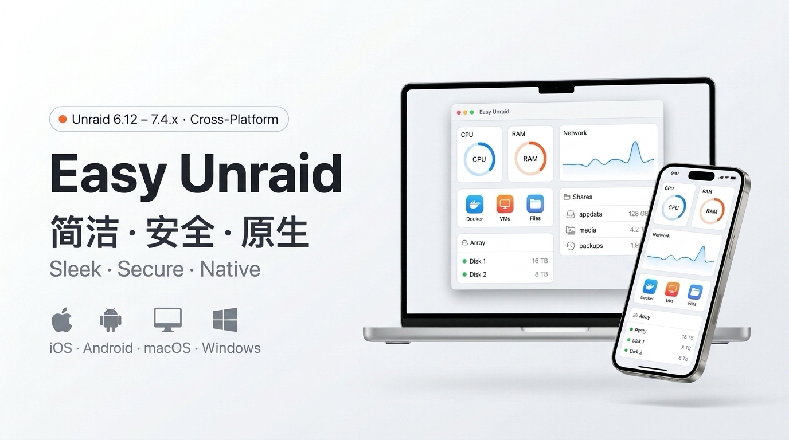
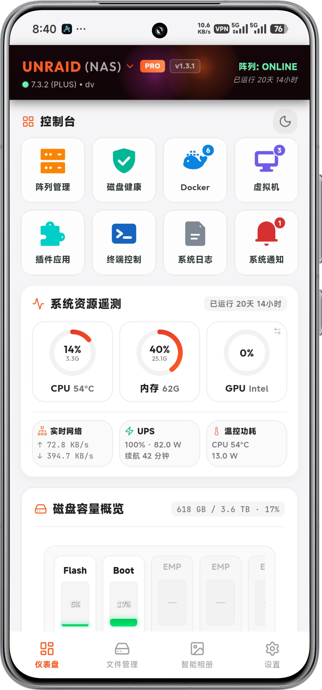
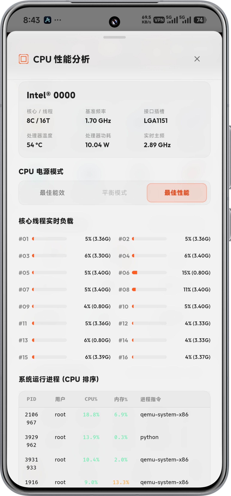
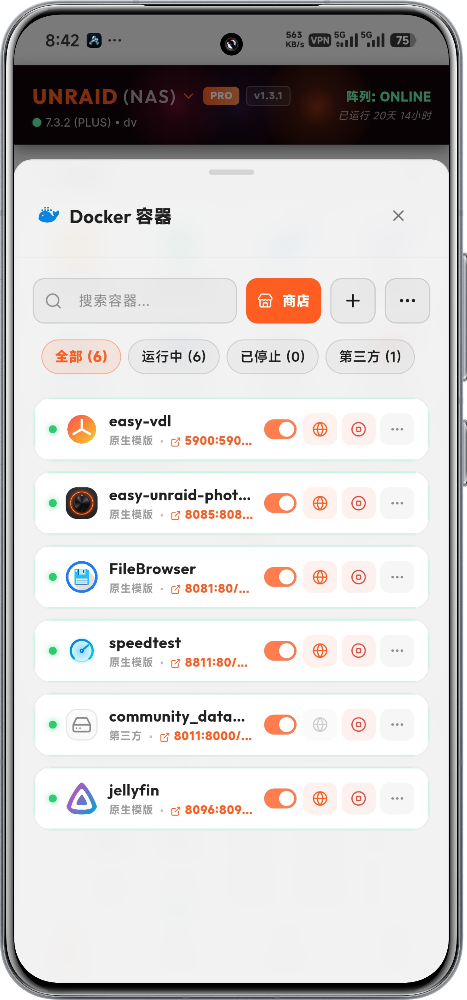
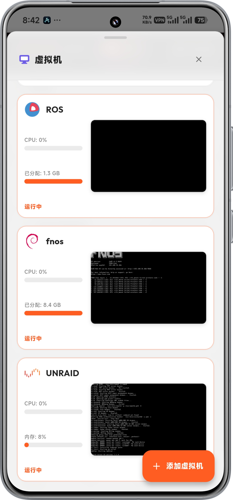
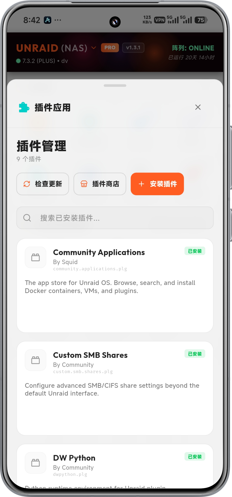
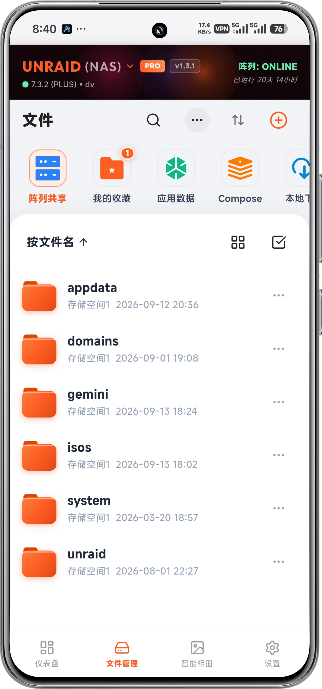
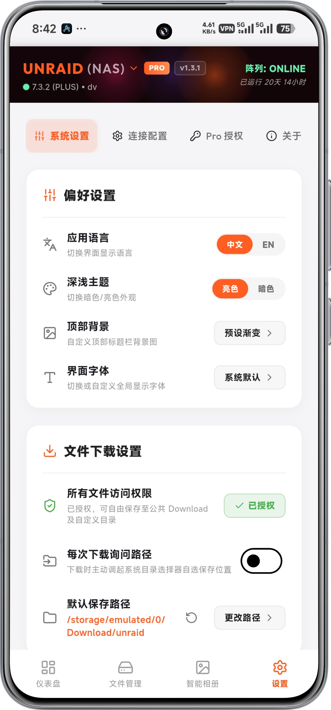

<a name="readme-top"></a>

# 🚀 Easy Unraid

<p align="center">
  
</p>

<p align="center">
  <strong>简洁、优雅且安全的跨平台 Unraid 服务器原生客户端（适配 Unraid 6.12 ~ 7.4.x）</strong><br/>
  <sub>A sleek, fast, and secure cross-platform native manager for Unraid 6.12 – 7.4.x</sub>
</p>

<p align="center">
  <a href="https://apps.apple.com/app/id6794758591"></a>
  <a href="https://github.com/wlaosj/easy-unraid-releases/releases/latest"></a>
  <a href="https://gitee.com/wdv880518/easy-unraid/releases"></a>
  <a href="https://t.me/+7jcTMePlNVwwZjg1"></a>
  
</p>

<p align="center">
  <a href="#zh">🇨🇳 中文文档</a> &nbsp;·&nbsp; <a href="#en">🇺🇸 English</a> &nbsp;·&nbsp; <a href="#screenshots">📸 界面预览</a>
</p>

<p align="center">
  
</p>

---

<a name="zh"></a>

## 🇨🇳 中文介绍

### 📥 客户端下载

前往 **[GitHub Releases](https://github.com/wlaosj/easy-unraid-releases/releases/latest)** 或 **[Gitee 国内高速镜像](https://gitee.com/wdv880518/easy-unraid/releases)** 获取安装包：

| 平台 | 渠道 / 格式 | 说明 |
| :--- | :---: | :--- |
| **📱 iOS / iPadOS** | `App Store` / `TestFlight` | [App Store 下载](https://apps.apple.com/app/id6794758591)（外区 ID）· [TestFlight 公测](https://testflight.apple.com/join/kQwMzc1a)（全区直装） |
| **🤖 Android** | `Easy-Unraid-Android.apk` | ARM64 硬件加速，HarmonyOS 4.x 及以下可直接安装 |
| **💻 macOS** | `Easy-Unraid-macOS.dmg` | 拖入 `Applications` 即可使用，支持应用内静默更新 |
| **🪟 Windows** | `Easy-Unraid-Windows.zip` | 解压后运行 `easy_unraid.exe`（绿色免安装） |

### ✨ 核心亮点

- **🎨 苹果白金双端工作台**：全新轻盈浅色与暗夜主题，支持 76 款 Unraid 原生机箱图标同步，桌面端全屏双栏与悬浮模态窗适配。
- **📊 硬件遥测与桌面小组件**：实时监控 CPU、内存、网络波形、多卡 GPU 趋势曲线、UPS 功耗与磁盘 SMART 状态，支持 iOS / Android / macOS 原生桌面小组件。
- **🐳 Docker、零侵入 Compose v2 与应用商店**：对齐 Unraid WebUI 参数与原生模版，支持实时流式拉取进度、零侵入 Compose v2（含 `.env` 双标签编辑与日志）及 CA 应用商店一键装配与 `.plg` 插件流式安装。
- **🚀 虚拟机与内置终端**：支持 VM 全链路参数编辑、运行态只读保护、无缝 Web VNC 控制台及全功能 SSH 终端。
- **📁 极速文件管理与离线办公**：SFTP 断点续传、桌面拖拽上传、在线智能防套娃解压（ZIP / RAR / 7Z / TAR）、物理回收站，以及纯客户端 Word / Excel / PPT / CSV 离线预览与编辑。
- **🧠 自托管 AI 智能相册与私密相册**：配合轻量容器 `easy-unraid-photos` 实现离线 CLIP 语义搜图、本地人脸聚类、原画秒播，以及物理隔离、独立鉴权的「私密相册」。
- **🎬 影院播放器与 SODA 离线 AI 同传**：桌面双栏影院与移动端画中画手势；内置 8 国离线语音模型实时双语滚动字幕，媒体库底层强制只读（`ro`）防误删。

### 💎 免费版 vs Pro 专业版

> **授权政策**：绑定 Unraid 引导 U 盘唯一硬件 GUID，**1 份 Pro 授权最多覆盖 3 台 Unraid 宿主机**，所有连接该服务器的手机、平板与电脑**自动解锁全部 Pro 功能，不限客户端数量**（支持自助注销换绑；iOS 端内直接通过 Apple IAP 购买与恢复）。

| 功能范围 | 免费版 | Pro 专业版 |
| :--- | :---: | :---: |
| 实时硬件仪表盘、3D 机箱阵列概览、安全登录审计 | ✅ 免费 | ✅ |
| 多服务器切换、局域网直连 / SSH 加密隧道、官方内嵌客服与一键脱敏排障 | ✅ 免费 | ✅ |
| 基础视频播放 | ✅ 免费 | ✅ 全功能影院 |
| Docker / Compose v2 / CA 商店 / 插件批量升级 / VM 与 VNC / SSH 终端 | — | ✅ 解锁 |
| SFTP 文件管理 / 离线 Office / 智能解压 / AI 相册与私密相册 / SODA 离线同传 / 磁盘 SMART 详情 | — | ✅ 解锁 |

### 🚀 3 步快速配对与安全承诺

1. **选择连接模式**：局域网或 VPN（WireGuard / Tailscale）推荐**直连模式**；公网无 VPN 推荐仅映射 SSH 端口走 **SSH 加密隧道**。
2. **SSH 密钥配对**：支持输入密码自动注入密钥（**成功后立即从内存物理抹除密码，绝不落盘明文密码**），也支持极客手动复制公钥追加至 `/boot/config/ssh/authorized_keys`。
3. **开源与直连审计**：客户端直连宿主机零云端中转，核心 SSH 与配对组件已 100% 开源接受审计：[wlaosj/easy-unraid-ssh](https://github.com/wlaosj/easy-unraid-ssh)。

<details>
<summary><b>🔒 极客安全加固与应急恢复脚本（点击展开）</b></summary>

配对成功后，可在「设置 ➔ 连接配置」中一键开启「禁用 SSH 密码登录」（持久化写入 `/boot/config/ssh/sshd_config`），彻底免疫公网字典爆破。若客户端丢失需恢复密码登录，可在 Unraid WebUI 终端执行：

```bash
if [ ! -f /boot/config/ssh/sshd_config ]; then cp /etc/ssh/sshd_config /boot/config/ssh/sshd_config; fi
grep -q "^KbdInteractiveAuthentication" /boot/config/ssh/sshd_config || echo "KbdInteractiveAuthentication yes" >> /boot/config/ssh/sshd_config
grep -q "^KbdInteractiveAuthentication" /etc/ssh/sshd_config || echo "KbdInteractiveAuthentication yes" >> /etc/ssh/sshd_config
sed -i 's/^#\?PasswordAuthentication.*/PasswordAuthentication yes/g' /boot/config/ssh/sshd_config /etc/ssh/sshd_config
sed -i 's/^#\?ChallengeResponseAuthentication.*/ChallengeResponseAuthentication yes/g' /boot/config/ssh/sshd_config /etc/ssh/sshd_config
sed -i 's/^#\?KbdInteractiveAuthentication.*/KbdInteractiveAuthentication yes/g' /boot/config/ssh/sshd_config /etc/ssh/sshd_config
/etc/rc.d/rc.sshd restart
```

</details>

---

<a name="en"></a>

## 🇺🇸 English

### 📥 Downloads

Grab the latest release from **[GitHub Releases](https://github.com/wlaosj/easy-unraid-releases/releases/latest)** or **[Gitee Mirror](https://gitee.com/wdv880518/easy-unraid/releases)**:

| Platform | Package / Channel | Notes |
| :--- | :---: | :--- |
| **📱 iOS / iPadOS** | `App Store` / `TestFlight` | [App Store](https://apps.apple.com/app/id6794758591) · [TestFlight Beta](https://testflight.apple.com/join/kQwMzc1a) |
| **🤖 Android** | `Easy-Unraid-Android.apk` | Hardware-accelerated ARM64 build |
| **💻 macOS** | `Easy-Unraid-macOS.dmg` | Drag to `Applications`; supports silent in-app updates |
| **🪟 Windows** | `Easy-Unraid-Windows.zip` | Extract and run `easy_unraid.exe` (portable) |

### ✨ Key Highlights

- **🎨 Apple Platinum Dual-Platform UI**: Clean light & dark modes with 76 native Unraid chassis icons, split-pane desktop workspaces, and centered floating modals.
- **📊 Real-Time Telemetry & Native Widgets**: Live CPU, RAM, network waveforms, per-GPU load curves, UPS power draw, drive SMART health, and system widgets on iOS / Android / macOS.
- **🐳 Docker, Zero-Intrusion Compose v2 & CA Store**: Full Unraid WebUI template parity, streaming per-layer pull progress, zero-intrusion Compose v2 (`.env` dual-tab editor & stack logs), and live `.plg` plugin streaming installs.
- **🚀 VM Management & SSH Terminal**: Full VM config editing with read-only protection for running VMs, seamless Web VNC console, and embedded SSH terminal.
- **📁 Turbo SFTP & Offline Office Suite**: Resumable SFTP transfers, desktop drag-and-drop uploads, smart archive extraction (ZIP / RAR / 7Z / TAR), physical trash bin, and client-side Word / Excel / PPT / CSV preview & editing.
- **🧠 Self-Hosted AI Gallery & Private Vault**: Powered by `easy-unraid-photos` for offline CLIP semantic search, local face clustering, raw video streaming, and an isolated Private Vault with dedicated token lock.
- **🎬 Cinema Video Player & SODA Offline AI Subtitles**: Desktop dual-column theater & mobile PiP gestures, plus 8 on-device speech models for real-time bilingual subtitles with read-only (`ro`) media protection.

### 💎 Free vs Pro & Licensing

> **One License, Unlimited Clients**: Bound to your Unraid boot flash GUID (**up to 3 Unraid hosts per license**). Every phone, tablet, and desktop connecting to an activated server unlocks Pro automatically (self-service unbind supported; Apple IAP available on iOS).

| Features | Free | Pro |
| :--- | :---: | :---: |
| Real-time dashboard, 3D chassis overview, security login audit | ✅ Free | ✅ |
| Multi-server switch, LAN Direct / SSH Tunnel, in-app support & sanitized logs | ✅ Free | ✅ |
| Basic video playback | ✅ Free | ✅ Cinema Mode |
| Docker / Compose v2 / CA Store / Batch plugin updates / VM & VNC / SSH terminal | — | ✅ Unlocked |
| SFTP manager / Offline Office / Smart extract / AI Gallery & Private Vault / SODA subtitles / SMART details | — | ✅ Unlocked |

### 🚀 Quick Start & Security

1. **Connection Mode**: Use **Direct Connection** on LAN or VPN (WireGuard / Tailscale), or **SSH Tunneling** over WAN without exposing management ports.
2. **Zero Plaintext Passwords**: Supports one-step key injection (passwords are wiped from memory immediately after pairing) or manual public-key setup in `/boot/config/ssh/authorized_keys`.
3. **Direct & Auditable**: Zero cloud relays. Core SSH & pairing logic is open-source at [wlaosj/easy-unraid-ssh](https://github.com/wlaosj/easy-unraid-ssh).

---

<a name="screenshots"></a>

## 📸 界面预览 (Screenshots)

<p align="left">
  
  &nbsp;&nbsp;
  
  &nbsp;&nbsp;
  
  &nbsp;&nbsp;
  
</p>
<p align="left">
  
  &nbsp;&nbsp;
  
  &nbsp;&nbsp;
  
  &nbsp;&nbsp;
  
</p>

<p align="right">(<a href="#readme-top">⬆️ 返回顶部 / Back to Top</a>)</p>
